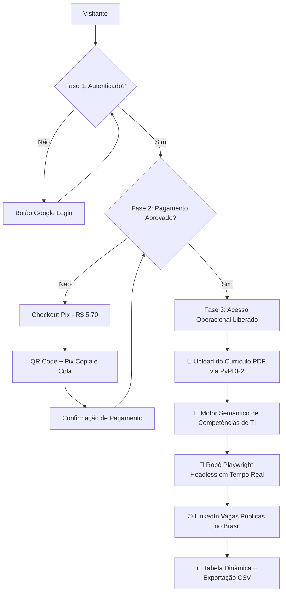

# ⚡ Radar Currículo IA - SaaS Comercial & Portfólio Seguro

[](https://www.python.org/)
[](https://streamlit.io/)
[](https://openai.com/)
[](https://playwright.dev/)
[](https://www.mercadopago.com.br/)
[](https://developers.google.com/identity)
[](LICENSE)

O **Radar Currículo IA** é uma aplicação web completa desenvolvida como **destaque de portfólio profissional para vagas de Júnior/Estágio em TI**. 

O projeto simula a experiência de um **SaaS comercial (Pay-per-use)** com autenticação Google e checkout Pix, implementado em uma arquitetura **100% segura para demonstração (sem necessidade de cartões de crédito ou chaves pagas)**, mantendo a **varredura real de vagas no LinkedIn com Playwright**.

---

## 📌 Destaques do Projeto

- 🔒 **Modo Demonstração Seguro (Zero Custos):** Não exige cadastro de cartão de crédito nem chaves de API pagas da OpenAI. A aplicação roda instantaneamente para qualquer recrutador ou desenvolvedor.
- 🧠 **Análise Semântica de Competências:** Extração real do texto do PDF via `PyPDF2`, acompanhada de uma barra de progresso visual simulando o modelo de linguagem e entregando palavras-chave realistas de TI (ex: *Python*, *Streamlit*, *Automação*).
- 🌐 **Web Scraping REAL com Playwright & Filtros Avançados:** O robô headless do Playwright é 100% real e gratuito: varre a busca pública do LinkedIn em tempo real (sem login), suportando filtros de localização (País, Estado, Cidade) e modelo de trabalho oficial do LinkedIn (Presencial, Remoto ou Híbrido).
- 💳 **Fluxo Completo de SaaS em 3 Fases (`st.session_state`):**
  - **Fase 1 (Não logado):** Landing page escura com botão oficial de login com Google.
  - **Fase 2 (Logado, sem pagamento):** Checkout com Pix de R$ 5,70, QR Code e Pix Copia e Cola.
  - **Fase 3 (Logado e pago):** Desbloqueio da área operacional, upload de PDF, análise e tabela com download em CSV.
- 🎨 **Design Dark Moderno e Profissional:** Interface sofisticada desenvolvida em Streamlit com tema dark, cards estilizados e badges reativas.

---

## 🏗️ Arquitetura do Sistema



### Estrutura Modular de Arquivos

```
RadarCurriculo_IA/
│
├── app.py                # Interface visual Streamlit (frontend e controle de sessão)
├── modules/              # Módulos de regras de negócio e integrações
│   ├── __init__.py       # Exportações públicas dos módulos
│   ├── leitor_ia.py      # Extração de texto em PDF (PyPDF2) e análise semântica
│   ├── scraper_publico.py # Robô de raspagem pública no LinkedIn (Playwright)
│   ├── auth_google.py    # Autenticação Google OAuth 2.0 e modo demonstração
│   └── pagamento_mp.py   # Gateway Mercado Pago Pix e simulação de checkout
├── samples/              # Arquivos de exemplo para teste
│   └── curriculo_exemplo.pdf # Exemplo de currículo para demonstração
├── tests/                # Testes unitários automatizados
│   ├── __init__.py
│   └── test_modulos.py   # Validação de regras e integrações
├── requirements.txt      # Dependências do projeto
├── .env.example          # Modelo seguro de variáveis de ambiente
├── .gitignore            # Regras de exclusão do Git
└── README.md             # Documentação técnica do projeto
```

---

## 🚀 Como Executar Localmente

Como o projeto está configurado para demonstração sem custos, **você não precisa de nenhuma chave de API para rodar a aplicação imediatamente**!

### 1. Clonar ou Acessar o Diretório
```bash
cd c:\Users\User\Documents\RadarCurriculo_IA
```

### 2. Instalar as Dependências
```bash
pip install -r requirements.txt
playwright install chromium
```

### 3. Iniciar a Aplicação
```bash
streamlit run app.py
```

Acesse no navegador: `http://localhost:8501`

---

## 👨‍💻 Sobre o Autor

Projeto desenvolvido como destaque de portfólio prático voltado para vagas de **Júnior / Estágio em Desenvolvimento de Software & IA**.

- **Perfil:** Desenvolvedor focado em Python, Automação Web e Engenharia de Software.
- **Formação:** Futuro estudante de **Análise e Desenvolvimento de Sistemas (ADS)** com início previsto para **Janeiro/2027**.
- **Objetivo:** Aplicar conceitos sólidos de arquitetura limpa, segurança, automação em tempo real e experiência de usuário (UX) em aplicações modernas.

---

## 📄 Licença

Distribuído sob a licença [MIT](LICENSE).
